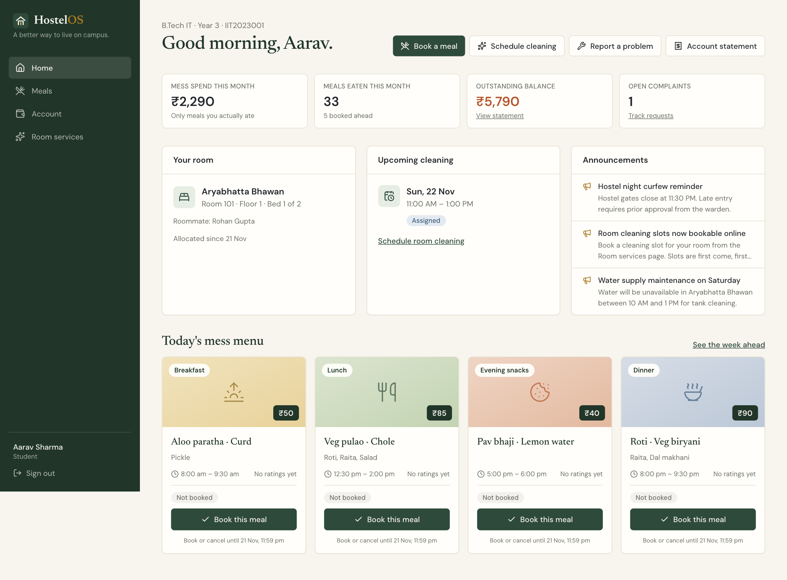
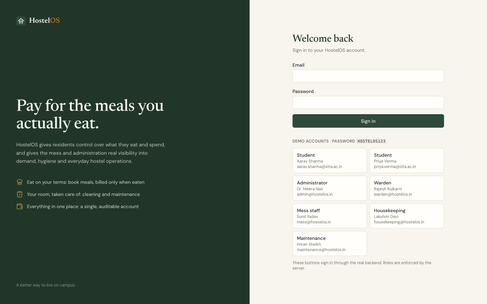
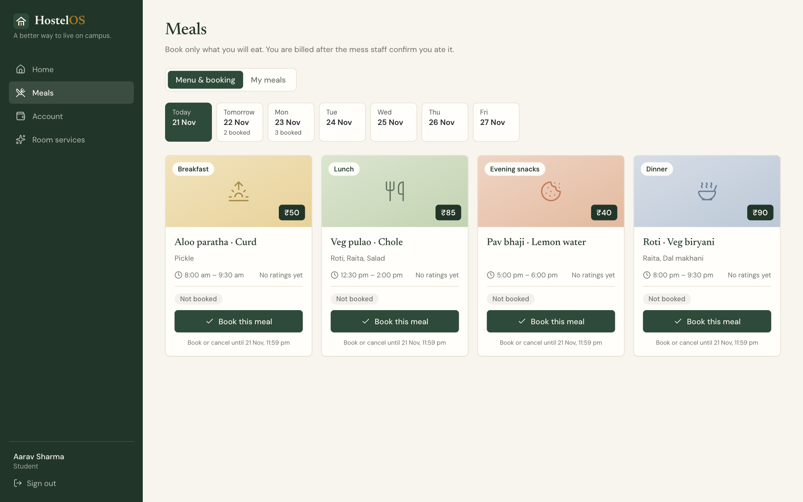
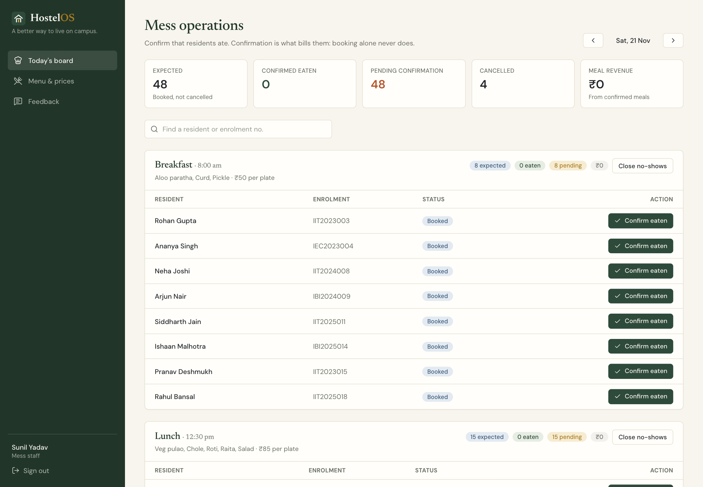
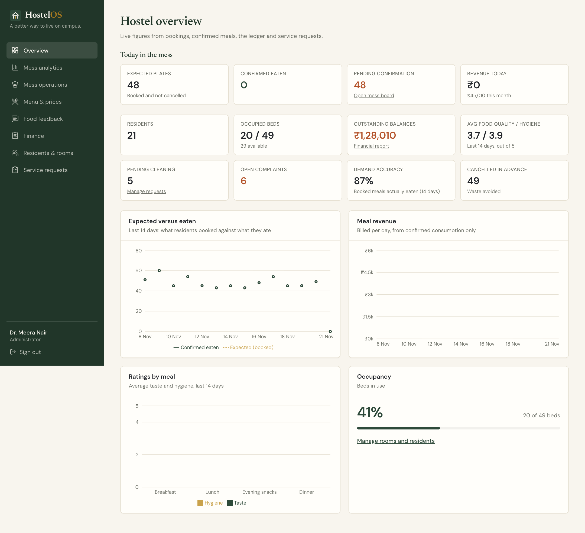
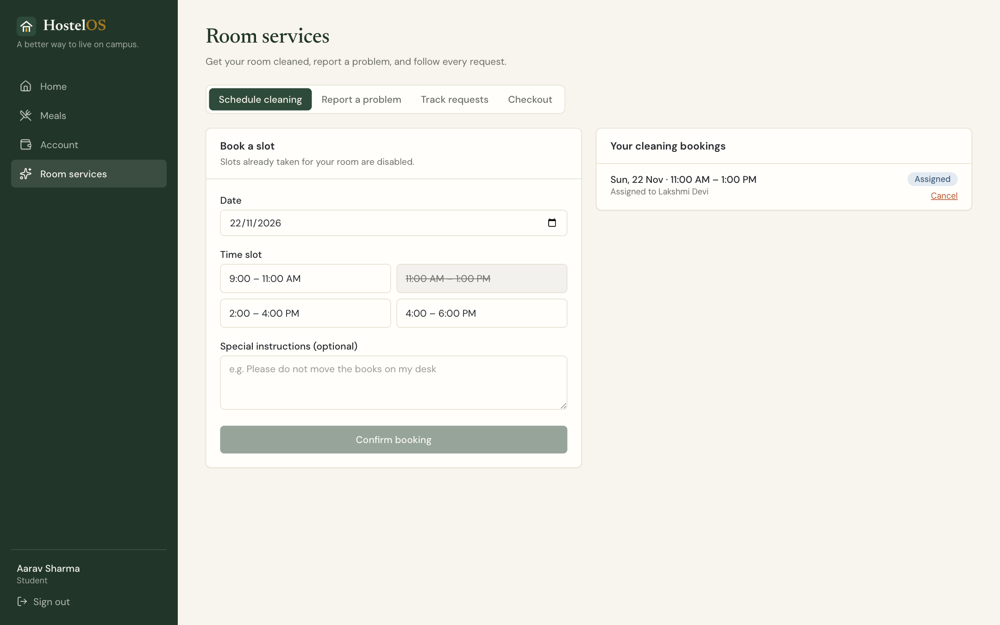
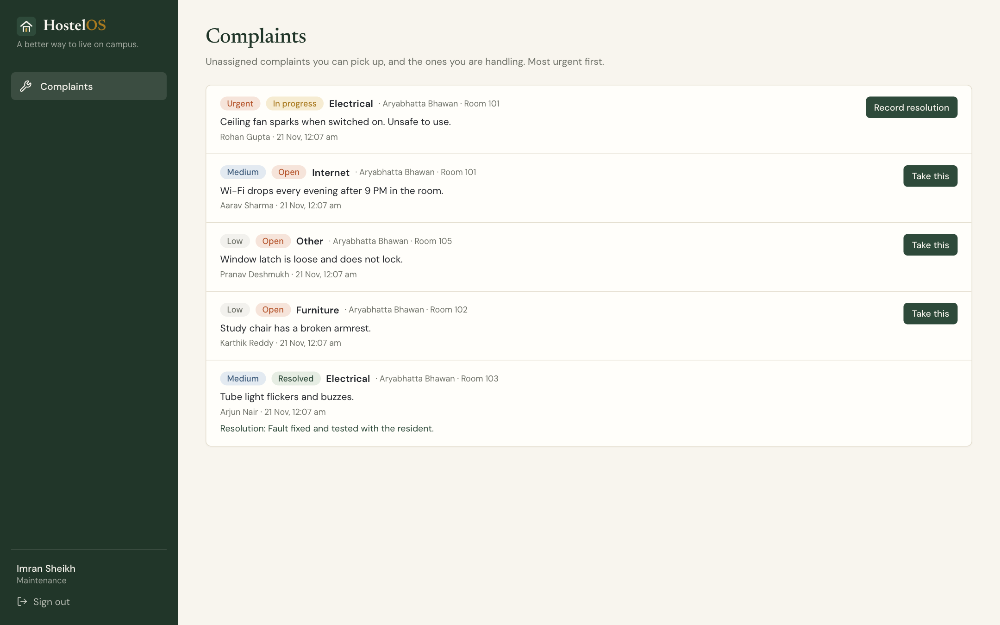
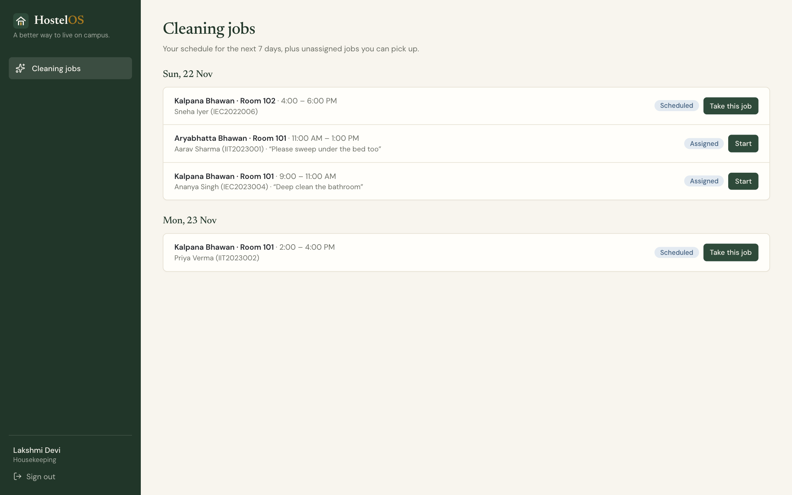
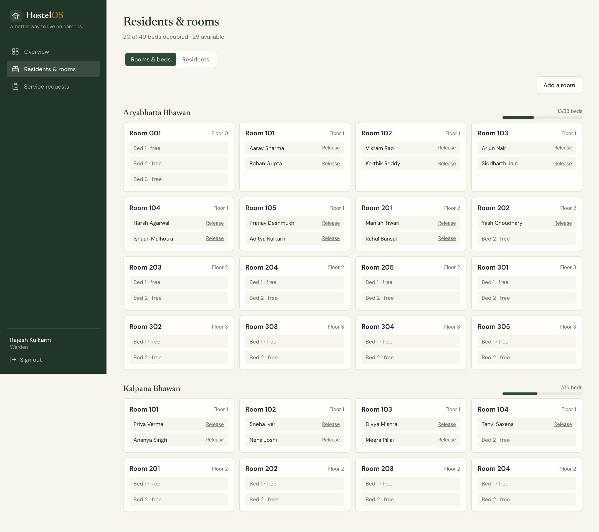
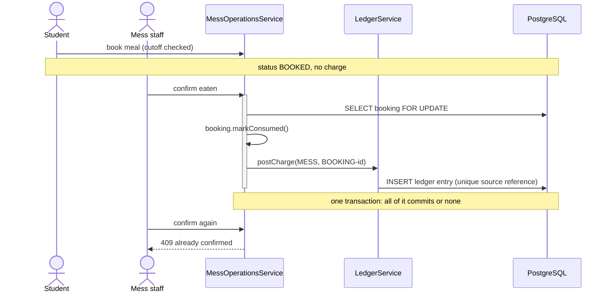

<div align="center">

# HostelOS

**A better way to live on campus.**

An integrated hostel management system built around one idea: *students pay only for the meals they actually eat.*




</div>

---

## Why HostelOS

In many hostels the mess fee is fixed: students pay whether or not they eat, the mess cannot see demand in advance, complaints about food, cleaning and repairs are verbal and untracked, and records of rooms and money are scattered across registers.

HostelOS replaces that with one system:

1. A student **books** a meal in advance. Booking is *not* billing.
2. Mess staff **confirm** that the student actually ate it.
3. Only then does the system post **exactly one** charge to the student's ledger, in the same database transaction.

Around that core sit accommodation, room cleaning, maintenance complaints, checkout clearance, announcements and role-specific dashboards for six kinds of user.

## Key features

Everything below is implemented and can be exercised through the UI and the REST API. Gaps are listed honestly in [Limitations](#limitations-and-roadmap).

| Area | What it does |
|---|---|
| **Pay-per-meal** | Daily menus with prices and booking cutoffs; book, cancel and re-book before the cutoff; booking history; statuses `NOT_BOOKED`, `BOOKED`, `CANCELLED`, `CONSUMED`, `MISSED` |
| **Billing** | Staff confirmation and the ledger charge happen in one transaction. Duplicate billing is blocked in five layers: entity state machine, row lock, idempotent service, unique constraint, append-only table |
| **Financial ledger** | Append-only per-resident ledger (charges, payments, refunds, adjustments), running-balance statement, reversals instead of edits, monthly rent posting. Payments are **simulated** (no gateway) |
| **Mess operations** | Daily board with expected / eaten / pending / cancelled counts and revenue, confirm eaten, close no-shows, edit menu and price, review food feedback |
| **Feedback and analytics** | Taste and hygiene ratings (only for meals actually eaten), rating distribution, popular and poorly rated meals, mess analytics for 7/14/30 days |
| **Accommodation** | Hostels, rooms, beds; allocate, transfer, release; rule-based bed recommendations (two interchangeable strategies); the database prevents double allocation |
| **Housekeeping** | Students book cleaning slots (taken slots are disabled), staff claim or are assigned jobs and move them through a controlled status workflow with notes |
| **Maintenance** | Students report problems by category and priority; staff claim, start and record a resolution; the student closes the complaint; illegal status jumps are refused |
| **Checkout** | Request, live clearance checks (dues, open complaints, pending cleaning), clear (releases the bed, history is kept) or reject |
| **Dashboards** | Student, warden and administrator dashboards computed from live records, plus announcements |
| **Auth and roles** | Stateless JWT login for 6 roles (student, warden, administrator, mess, housekeeping and maintenance staff); a role check on every endpoint, enforced server-side |

## Screenshots

Captured from the running application with the seeded demo data (`DEMO_MODE=true`).

| | |
|---|---|
|  <br> **Login** with one-click demo accounts (demo mode only) |  <br> **Meal booking**: book only what you will eat |
|  <br> **Mess board**: staff confirm who ate |  <br> **Administrator dashboard** |
|  <br> **Room services**: cleaning slots |  <br> **Maintenance staff** queue |
|  <br> **Housekeeping staff** jobs |  <br> **Residents and rooms** (warden) |

More in [`docs/screenshots/`](docs/screenshots): student account statement, menu manager, mess analytics and finance report.

## Architecture at a glance

A **modular monolith**: one Spring Boot application, one PostgreSQL database and one React single-page app talking to it over REST/JSON. In production the React build is served by the same Spring Boot process, so there is one container and one URL.

```mermaid
flowchart LR
    B[Browser<br/>React 19 SPA] -- "REST/JSON + JWT" --> C
    subgraph S[Spring Boot 3.5 · Java 21]
        C[Controllers<br/>@PreAuthorize roles] --> V[Services<br/>transactions, business rules]
        V --> E[Entities<br/>state + invariants]
        V --> R[Repositories<br/>Spring Data JPA]
    end
    R --> D[(PostgreSQL 16<br/>Flyway schema)]
```

The pay-per-meal workflow:



Details: [docs/ARCHITECTURE.md](docs/ARCHITECTURE.md), [docs/DATABASE.md](docs/DATABASE.md), [docs/API.md](docs/API.md).

## Technology stack

Versions are taken from `backend/pom.xml` and `frontend/package.json`.

| Layer | Technology |
|---|---|
| Backend | Java 21, Spring Boot 3.5.0 (Web, Security, Data JPA, Validation), Hibernate, Lombok (`@Getter`, `@NoArgsConstructor`), JJWT 0.12.6, springdoc-openapi 2.8.9 (Swagger UI), Maven |
| Database | PostgreSQL 16, Flyway migrations |
| Frontend | React 19, TypeScript, Vite, Tailwind CSS 4, TanStack Query 5, React Router 7, Recharts 3, lucide-react |
| Testing | JUnit 5, Mockito, AssertJ, Spring Security Test, embedded PostgreSQL (zonky 2.1.0); Vitest, Testing Library, jsdom |
| Tooling | oxlint, Docker (multi-stage image), Docker Compose, GitHub Actions |
| Deployment config | `render.yaml` (Render Blueprint) designed for Render + Neon; see [docs/DEPLOYMENT.md](docs/DEPLOYMENT.md) |

## Getting started

### Prerequisites

- JDK 21 and Maven 3.9+
- Node.js 22+ and npm
- PostgreSQL 16, or Docker (the compose file starts PostgreSQL for you)

### Option A: everything in Docker (quickest)

```bash
git clone https://github.com/nihaaalravi07/HostelOS-Portfolio.git
cd HostelOS-Portfolio
cp .env.example .env            # then set JWT_SECRET to a long random value:  openssl rand -base64 48
docker compose --profile full up --build
```

Open <http://localhost:8080>. With `DEMO_MODE=true` (the value in `.env.example`) the login screen shows one-click demo accounts.

### Option B: run backend and frontend separately

```bash
# 1. PostgreSQL (skip if you already have one; defaults are database/user/password "hostelos")
docker compose up -d

# 2. Backend on http://localhost:8080
cd backend
export JWT_SECRET="$(openssl rand -base64 48)"   # required, there is no default
export DEMO_MODE=true                            # seeds demo data; omit for an empty database
mvn spring-boot:run

# 3. Frontend on http://localhost:5173 (proxies /api to :8080)
cd ../frontend
npm ci
npm run dev
```

If port 5432 is already in use, start the database with `POSTGRES_PORT=5433 docker compose up -d` and pass `DB_URL=jdbc:postgresql://localhost:5433/hostelos` to the backend. Swagger UI is at <http://localhost:8080/swagger-ui.html>.

### Demo accounts

Only available when `DEMO_MODE=true`. All demo accounts share the password `hostelos123`, which you can change with `DEMO_PASSWORD`. They exist so the application can be explored without registering; **never enable demo mode on a real deployment.**

| Role | Email |
|---|---|
| Student | `aarav.sharma@iiita.ac.in`, `priya.verma@iiita.ac.in` |
| Administrator | `admin@hostelos.in` |
| Warden | `warden@hostelos.in` |
| Mess staff | `mess@hostelos.in` |
| Housekeeping | `housekeeping@hostelos.in` |
| Maintenance | `maintenance@hostelos.in` |

A suggested walkthrough is in [docs/DEMO.md](docs/DEMO.md).

## Testing

```bash
cd backend  && mvn test        # JUnit 5; integration tests start their own embedded PostgreSQL, no setup needed
cd frontend && npm test        # Vitest
cd frontend && npm run build   # type-checks (tsc) and builds
```

Results verified for this repository state (Java 21, Node 24, macOS, 21 Nov 2026):

- Backend: **51 tests, 0 failures** (unit tests, Mockito service tests, and full-stack integration tests against a real PostgreSQL, including a duplicate-billing concurrency test).
- Frontend: **11 tests, 0 failures**; `npm run build` succeeds.

The tests do not cover everything. Frontend coverage is low and there is no browser end-to-end suite; see [docs/PROJECT_STATUS.md](docs/PROJECT_STATUS.md). The GitHub Actions workflow in [`.github/workflows/ci.yml`](.github/workflows/ci.yml) runs the backend build, the frontend tests and build, and a Docker image build on every push and pull request.

## Deployment

The repository ships a multi-stage `Dockerfile` (React build + Spring Boot jar in one small image) and a `render.yaml` Blueprint intended for Render with a Neon PostgreSQL database. **This repository lists no public demo link, and the configuration is provided as prepared, not as proof of a running service.** Required environment variables: `JWT_SECRET`, a database setting (`DATABASE_URL`, or `DB_URL`/`DB_USER`/`DB_PASSWORD`), and optionally `SITE_PASSCODE`, `DEMO_MODE`, `PORT`. Full guide: [docs/DEPLOYMENT.md](docs/DEPLOYMENT.md).

## Project structure

```
HostelOS-Portfolio/
├── backend/                 Spring Boot application (Java 21, Maven)
│   └── src/main/java/com/hostelos/
│       ├── user, security   accounts, roles, JWT, method security
│       ├── resident, accommodation, mess, finance
│       ├── housekeeping, maintenance, checkout, dashboard
│       └── common, config   error handling, demo seeding, OpenAPI
│   └── src/main/resources/db/migration/V1__schema.sql
├── frontend/                React + TypeScript + Vite single-page app
├── scripts/                 single-jar build, end-to-end smoke test
├── docs/                    architecture, API, database, deployment, status, screenshots
├── evaluation/              academic deliverables (Software Engineering and OOM)
├── Dockerfile, docker-compose.yml, render.yaml
└── .github/workflows/ci.yml
```

## Limitations and roadmap

**Known limitations** (full list in [docs/PROJECT_STATUS.md](docs/PROJECT_STATUS.md)):

- Payments are simulated; there is no payment gateway.
- No UI or endpoint to create or edit users, residents or roles (`GET /api/users` is read-only); announcements can be posted through the API but there is no form for it in the UI.
- Monthly rent is posted by an administrator action, not on a schedule.
- No refresh tokens, rate limiting or account lockout; the optional site passcode is a convenience gate, not strong security.
- No browser end-to-end tests; the frontend ships as a single bundle with no code splitting.

**Ideas for future work** (none of this exists yet): a real payment gateway, scheduled rent posting, user and resident administration screens, QR-code meal check-in, notifications, route-level code splitting and end-to-end browser tests.

## Academic context

HostelOS was developed as a software engineering and object-oriented design project for academic evaluation at **IIIT Allahabad**. The [`evaluation/`](evaluation) folder holds the reports, requirement and architecture documents, test and risk documentation, UML diagrams, concept mapping and viva material produced for the Software Engineering and Object-Oriented Methodologies courses. It is not a production system and has no production users.

The software was built with AI assistance (Claude Code). See [evaluation/README.md](evaluation/README.md) for what each document contains.

## Contributing

Issues and pull requests are welcome; see [CONTRIBUTING.md](CONTRIBUTING.md).

## License

No license has been chosen yet, so all rights are reserved by the authors for now. If you would like to reuse this code, please open an issue.
