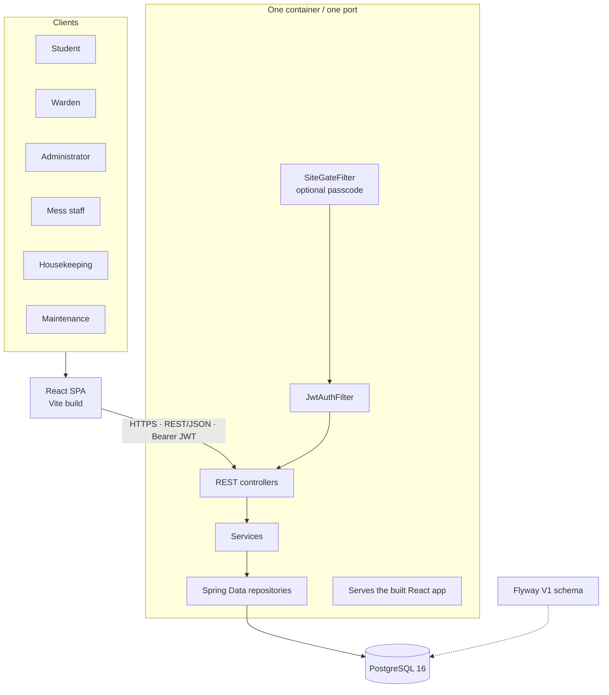
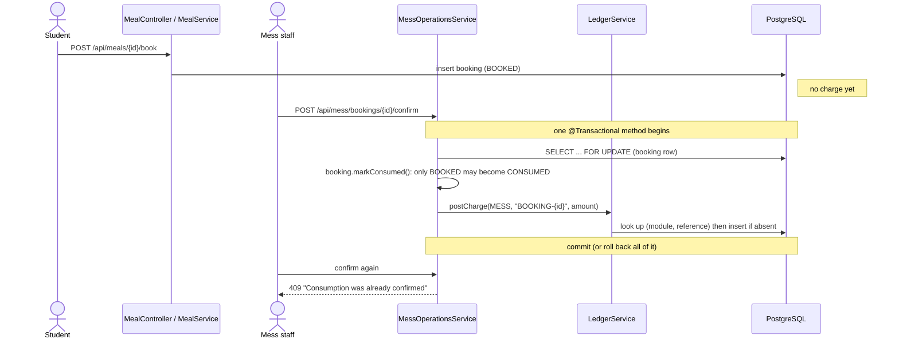
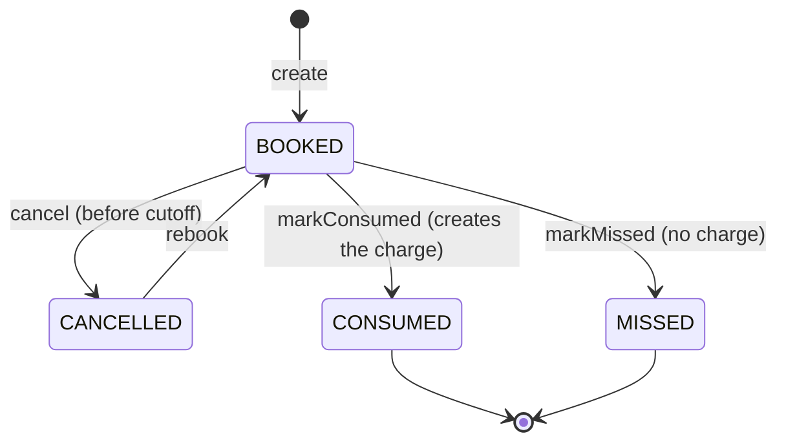
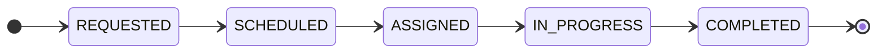
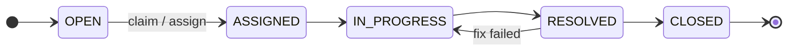

# Architecture

HostelOS is a **modular monolith**: one Spring Boot application, one PostgreSQL database and one React single-page app that talks to the backend over REST/JSON. Code is organised by **business module**, not by technical layer.

## System context



In development the Vite dev server (port 5173) proxies `/api` to the backend (port 8080). In the production image the React build is copied into the Spring Boot jar's static resources, so the UI and the API share one origin and no CORS is needed.

## Backend modules

```
com.hostelos
├── config         DemoDataSeeder, SiteGateFilter, SpaWebConfig, OpenApiConfig, SchedulingConfig, DatabaseUrlPostProcessor
├── security       JwtService, JwtAuthFilter, SecurityConfig, CurrentUser, AuthUser
├── user           User, Role, UserService, AuthController, UserController
├── resident       Resident profile + ResidentSummary read model
├── accommodation  Hostel, Room, Bed, Allocation, AllocationStrategy (Pack / Spread)
├── mess           Meal, MealBooking, FoodFeedback, MealService, MessOperationsService, analytics
├── finance        LedgerEntry (append-only), LedgerService, charge calculators
├── housekeeping   CleaningRequest, slots, CleaningStatus lifecycle
├── maintenance    Complaint, ComplaintStatus lifecycle
├── checkout       CheckoutRequest, clearance rules
├── dashboard      Student / warden / admin read models, announcements
└── common         BusinessException, GlobalExceptionHandler
```

Each feature package holds its own entities, repository interfaces, services, controller and DTO records. The generated package-dependency figure is in the OOM report ([`evaluation/OOM`](../evaluation/OOM)); the only package cycle is `user` ↔ `security`.

### Layers and responsibilities

| Layer | Responsibility | Rules |
|---|---|---|
| Controller (`@RestController`) | Translate HTTP to a method call, validate the body (Bean Validation), declare the role rule with `@PreAuthorize` | No business rules; entities are never serialised |
| Service (`@Service`) | One use case per method, usually one transaction; coordinates entities and other modules | A module touches only its own tables; other modules are reached through their service |
| Entity (`@Entity`) | State plus the rules that protect it (`cancel()`, `markConsumed()`, `moveTo()`) | Private fields, no public setters (one exception: `CleaningRequest.setAssignee`) |
| Repository | Persistence interface implemented by Spring Data | Custom queries by method name or `@Query`; one pessimistic-lock query for booking confirmation |
| Database | Last line of defence: constraints, partial unique indexes, a trigger | See [DATABASE.md](DATABASE.md) |

### Module boundaries

- Cross-module references are plain `Long` ids (for example `residentId`), not JPA associations. JPA relationships exist only inside a module.
- Data crosses modules as read-model records (`ResidentSummary`, `AccommodationInfo`).
- Dependencies point one way: `mess → finance`, `finance → resident/accommodation`, `checkout` and `dashboard` compose other modules read-only. `finance` knows nothing about meals: the mess hands it a charge with a source module and reference.

## Authentication and authorisation

1. `POST /api/auth/login` checks the email and BCrypt password and returns a **JWT** (HS256, 12-hour expiry) plus the user's id, name and role. The same message is returned for an unknown email and a wrong password.
2. `JwtAuthFilter` reads `Authorization: Bearer <token>` and, if valid, puts an `AuthUser(userId, email, role)` in the security context. The application is stateless (no server session).
3. `SecurityConfig` requires authentication for `/api/**` and permits the login, demo-account list, Swagger and static files. **Role checks sit on each controller method** with `@PreAuthorize` so the rule is visible next to the endpoint.
4. A resident's identity always comes from the token, never from a request parameter, so a student cannot request someone else's data.
5. The signing key comes from the required `JWT_SECRET` setting; the application refuses to start without it (and a key shorter than 32 bytes is rejected by the JWT library).
6. Optional `SITE_PASSCODE`: a servlet filter in front of everything asks visitors for a shared passcode (HttpOnly cookie). It is a convenience gate for public demo URLs, not strong security.

| Role | Main capabilities |
|---|---|
| `STUDENT` | Meals, own ledger, room services (cleaning, maintenance), checkout request, own dashboard |
| `MESS_STAFF` | Mess board, confirm consumption, close no-shows, menu and price, feedback, analytics |
| `HOUSEKEEPING_STAFF` | Cleaning board, claim and progress jobs |
| `MAINTENANCE_STAFF` | Complaint board, claim and resolve |
| `WARDEN` | Accommodation, assign work, checkout clearance, warden dashboard, announcements |
| `ADMIN` | Everything above plus finance (payments, reversals, rent), analytics, user listing |

The exact role list for every endpoint is in [API.md](API.md).

## Main workflows

### Pay-per-meal billing



Five layers prevent a duplicate charge: (1) the entity state machine, (2) the row lock that serialises concurrent confirmations, (3) the idempotent `postCharge`, (4) the `uq_ledger_source` unique constraint, (5) the append-only trigger on the ledger. Booking states: `NOT_BOOKED` (derived, no row), `BOOKED`, `CANCELLED`, `CONSUMED`, `MISSED`; only `CONSUMED` produces a charge.

### Booking lifecycle



### Cleaning and maintenance

Both use a controlled status machine whose legal transitions live in the status enum (`CleaningStatus.allowedNext()`, `ComplaintStatus.allowedNext()`); the entity refuses anything else with a `409`.



*Cleaning request (it can also be cancelled before the slot starts).*



*Maintenance complaint.*

The generated state diagrams in the OOM documentation show every edge.

## Important design decisions

| Decision | Reason |
|---|---|
| Modular monolith, not microservices | One team, one database, strong transactional needs (billing). Modules keep boundaries without network calls |
| Booking is not billing | Charging only on staff-confirmed consumption is the project's core idea and removes disputes over no-shows |
| Append-only ledger with a database trigger | Money records must not be edited; corrections are reversals, so history is auditable even if application code has a bug |
| Idempotent charge keyed by `(source_module, source_ref)` | Retries and double clicks cannot double-bill; the unique constraint covers races |
| Rules inside entities and enums | A rule such as "cancelled meals are never billed" holds on every code path instead of being repeated in controllers |
| Cross-module links by id | Keeps modules independent and avoids lazy-loading across module boundaries |
| Rules enforced at several layers | Validation, service, entity and database constraints each catch a different class of mistake |
| Records for DTOs and read models | Immutable, concise, and decouple the API from entities |
| Strategy for bed recommendations | `PackRoomsStrategy` and `SpreadRoomsStrategy` implement `AllocationStrategy`; Spring injects all of them and the request picks one by name |
| Stateless JWT | No session store; the single-container deployment stays simple |

Honest design notes (details in the OOM evaluation): `MessOperationsService` has about five responsibilities and could be split; `ChargeCalculator<S>` exists as an interface, but its call sites use the concrete classes; there is no catch-all exception handler.
