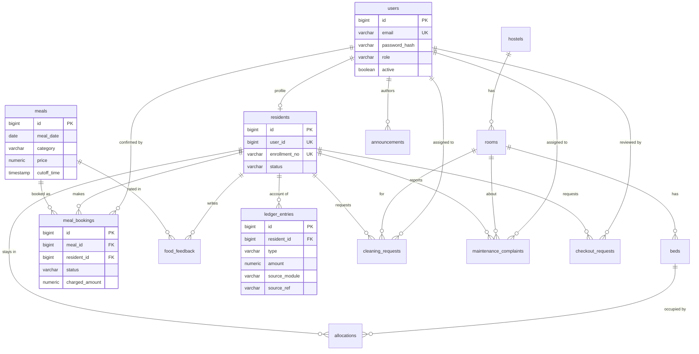

# Database

PostgreSQL 16, managed by **Flyway**. There is one migration, [`backend/src/main/resources/db/migration/V1__schema.sql`](../backend/src/main/resources/db/migration/V1__schema.sql), which creates 14 tables. Hibernate runs with `ddl-auto: validate`, so the schema is owned by Flyway and Hibernate only checks that the entities match it. Money is always `NUMERIC(12,2)`.

## Entity relationships

(The diagram shows every table and the foreign keys; only the most important columns are drawn. See the SQL for all columns.)

## Tables

| Table | Purpose |
|---|---|
| `users` | Login accounts. `role` is one of `STUDENT`, `WARDEN`, `ADMIN`, `MESS_STAFF`, `HOUSEKEEPING_STAFF`, `MAINTENANCE_STAFF`; password stored as a BCrypt hash |
| `residents` | Student profile, one per student user (`user_id` unique); `status` `ACTIVE` or `CHECKED_OUT` |
| `hostels`, `rooms`, `beds` | Accommodation hierarchy; `UNIQUE (hostel_id, room_number)` and `UNIQUE (room_id, bed_number)`; room capacity 1 to 6 |
| `allocations` | A resident's stay in a bed. `end_date IS NULL` means active; ended rows are kept as history |
| `meals` | One row per date and category (`BREAKFAST`, `LUNCH`, `SNACKS`, `DINNER`) with menu, price, cutoff time and availability |
| `meal_bookings` | A resident's booking of a meal: `BOOKED`, `CANCELLED`, `CONSUMED` or `MISSED`, who confirmed it and the amount charged |
| `food_feedback` | Taste and hygiene ratings (1 to 5) and a comment, one per resident and meal |
| `ledger_entries` | Append-only financial ledger: `CHARGE`, `PAYMENT`, `REFUND`, `ADJUSTMENT_DEBIT`, `ADJUSTMENT_CREDIT` |
| `cleaning_requests` | Room cleaning jobs with a slot and a status workflow |
| `maintenance_complaints` | Maintenance complaints with category, priority and a status workflow |
| `announcements` | Notices posted by wardens and administrators |
| `checkout_requests` | Checkout requests with the review outcome and the dues at review time |

## Constraints that enforce business rules

| Constraint | Rule it enforces |
|---|---|
| `uq_ledger_source` UNIQUE `(source_module, source_ref)` | At most one ledger entry per source transaction, so a meal can never be billed twice |
| Trigger `trg_ledger_immutable` (BEFORE UPDATE OR DELETE on `ledger_entries`) | The ledger is append-only; mistakes are corrected by posting a reversal |
| `CHECK (amount > 0)` on `ledger_entries` | A ledger amount is always positive; the entry type gives it direction |
| `uq_alloc_active_bed` partial unique index on `allocations(bed_id) WHERE end_date IS NULL` | A bed has at most one active occupant |
| `uq_alloc_active_resident` partial unique index on `allocations(resident_id) WHERE end_date IS NULL` | A resident has at most one active bed |
| `UNIQUE (meal_id, resident_id)` on `meal_bookings` | One booking row per resident and meal (cancel and re-book reuse the row) |
| `UNIQUE (meal_date, category)` on `meals` | One meal per date and category |
| `uq_cleaning_room_slot` partial unique index `(room_id, request_date, slot) WHERE status <> 'CANCELLED'` | No two live cleaning bookings for the same room, date and slot |
| `uq_checkout_pending` partial unique index on `checkout_requests(resident_id) WHERE status = 'PENDING'` | At most one pending checkout request per resident |
| `CHECK` constraints on every status, category, priority and rating column; `price >= 0`; `capacity BETWEEN 1 AND 6`; `year_of_study BETWEEN 1 AND 6` | Invalid values are rejected by the database even if application code is bypassed |

When the application hits one of these constraints (for example in a race), `GlobalExceptionHandler` turns the `DataIntegrityViolationException` into a `409 Conflict`.

## Indexes

Besides the unique indexes above: `idx_bookings_resident` on `meal_bookings(resident_id)` and `idx_ledger_resident` on `ledger_entries(resident_id)`.

## Migrations and seed data

- Flyway runs automatically at start-up (`spring.flyway.enabled: true`). To change the schema, add a new `V2__description.sql`; never edit `V1`.
- Seed data is **not** a migration. `DemoDataSeeder` runs at start-up only when `DEMO_MODE=true` and the database has no users; it creates two hostels, 24 rooms, demo accounts, residents with allocations, meal history (through the real billing path), ledger entries, cleaning and maintenance records and announcements. With `DEMO_MODE=false` the database starts empty, apart from a rolling window of meals that the application generates.
- To reset a local database: `docker compose down -v && docker compose up -d`.
